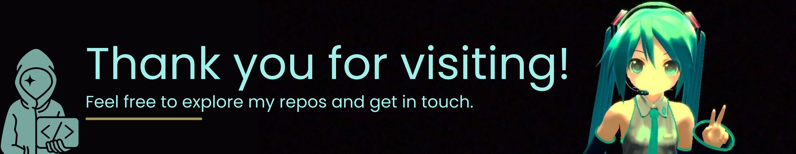

  
    
<blockquote>Turning ideas into code, exploring cybersecurity, and creating things from scratch.</blockquote>

 

   

     <h2>👩‍💻 About Me</h2>
     
I'm Amarah, an application developer and junior security engineer with a passion for technology, cybersecurity, and creativity.

     
I love understanding how things work, finding ways to improve them, and turning ideas into real projects. Whether it's developing applications, exploring security vulnerabilities, designing something in Canva, or building an entire game from scratch, I'm always looking for something new to learn.

     
Outside of programming, I enjoy hands-on creative projects, experimenting with different designs, and bringing unusual ideas to life.

     
One of my biggest long-term goals is to work in digital forensics within law enforcement, investigating cybercrime, analyzing digital evidence, and helping uncover the truth hidden inside digital devices.

   

   

     <h2>🚀 What I'm Up To</h2>
     <ul>
      <li>💻 Developing applications and improving my software engineering skills</li>
      <li>🔐 Expanding my knowledge of cybersecurity, security engineering, and ethical hacking</li>
      <li>🎮 Creating games and experimenting with game development</li>
      <li>🎨 Designing graphics, layouts, and creative projects using Canva</li>
      <li>🔎 Exploring digital forensics, forensic investigations, and cybercrime</li>
      <li>🛠️ Building random projects just because I thought they'd be cool</li>
    </ul>
  

   

     <h2>🚀 Current Projects</h2>
     <table>
       <tr>
          <td width="33%" valign="top">
          
          <h3>👽Project: EXOSIGNAL</h3>
          
Project: EXOSIGNAL is a first person shooter game on Roblox.

          
<strong>Stack:</strong> Luau · Blender

          <a href="https://roblox.com">🚀 Live Demo Coming Soon</a>
          </td>
          <td width="33%" valign="top">
            
            <h3>💅 Nailspo</h3>
            
A website where you can find and upload nail designs.

            
<strong>Stack:</strong> React · PostgreSQL

            <a href="https://nailspo.net">🚀 Live Demo</a>
          </td>
          <td width="33%" valign="top">
            
            <h3>🤫 Project Three is a secret</h3>
            
My next project will be coming soon. However.. it's a secret..~

            
<strong>Stack:</strong> xxx · xxx

            <a href="">🚀 Live Demo Coming Soon</a>
          </td>
        </tr>
     </table>
   

   

     <h2>🖼️ Gallery / Screenshots</h2>
     <table>
        <tr>
          <td width="25%"></td>
          <td width="25%"></td>
          <td width="25%"></td>
          <td width="25%"></td>
        </tr>
      </table>
   

  
  

    <h2>🔗 Connect With Me</h2>
    
    
    
    
    
    
    
  

  

    <h2>🛠️ Tech Stack</h2>
    <h3>💻 Programming Languages</h3>
      

        
        
        
        
        
        
        
        
        
        
        
        
      

      

      <h3>🌐 Frameworks & Backend</h3>
        
        
        
        
        
      

      

      <h3>🗄️ Databases</h3>
        
        
        
      

      

      <h3>🔐 Cybersecurity & Digital Forensics</h3>
        
        
        
        
        
        
        
        
        
      

      

      <h3>🎮 Game Development</h3>
        
        
        
      

      

      <h3>🎨 Design & Creative Tools</h3>
        
        
        
      

      

      <h3>⚙️ Development Tools</h3>
        
        
        
      

  

  
  
 
   
  

  

 
